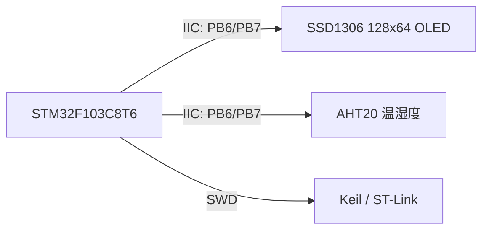
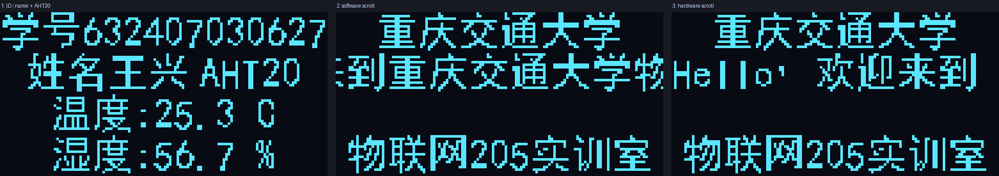
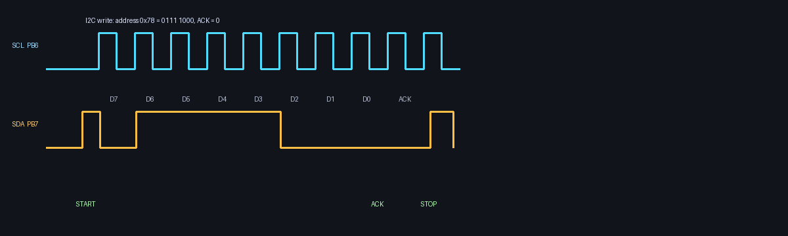

# STM32F103 OLED 显示实验报告

**任务一 + 任务二 合并版**

| 项目 | 内容 |
|---|---|
| 姓名 | 王兴 |
| 学号 | 632407030627 |
| 实验平台 | STM32F103C8T6 + 0.96 寸 SSD1306 IIC OLED + AHT20 |
| 开发环境 | Keil MDK 5.36、ARMCC V5.06 update 7、STM32CubeMX 6.3、U8g2 2.37.1 |
| 代码仓库 | <https://github.com/wangde111/shiyan3> |
| 实验日期 | 2026-10-26 |
| 报告说明 | 本文件将任务一（OLED_IIC）和任务二（OLED_U8G2）合并为一份完整实验报告，两部分相对独立，可按任务分别评分。 |

## 目录

- [一、实验目的](#一实验目的)
- [二、实验环境与硬件连接](#二实验环境与硬件连接)
- [三、任务一：SSD1306 IIC 显示、AHT20 与滚动显示](#三任务一ssd1306-iic-显示aht20-与滚动显示)
- [四、任务二：CubeMX HAL 框架 + U8g2 移植](#四任务二cubemx-hal-框架--u8g2-移植)
- [五、Keil 虚拟逻辑分析仪与 IIC SDA 波形分析](#五keil-虚拟逻辑分析仪与-iic-sda-波形分析)
- [六、实验总结](#六实验总结)
- [附录](#附录)

---

## 一、实验目的

1. 理解 0.96 寸 OLED（SSD1306）的显存结构、页地址/列地址寻址方式和 IIC 通信时序。
2. 掌握 16×16 汉字点阵的取模原理，能够把汉字字模显示到 OLED。
3. 使用 STM32F103 的 IIC 接口完成 OLED 显示，并读取 AHT20 温湿度。
4. 掌握水平、垂直滚动显示的实现方法，理解 SSD1306 硬件滚动与软件滚动的区别。
5. 使用 STM32CubeMX 建立 HAL 库工程框架，裁剪并移植 U8g2 图形库。
6. 掌握 U8g2 的文本、图形、位图、滚动和动画显示方法。
7. 分析 Keil 虚拟逻辑分析仪采集 IIC 波形的可行性，掌握替代调试手段。

---

## 二、实验环境与硬件连接

### 2.1 主要器件

| 器件 | 型号/参数 | 说明 |
|---|---|---|
| 主控 | STM32F103C8T6 | Cortex-M3，64 KB Flash，20 KB RAM |
| OLED | SSD1306 128×64 | 0.96 寸，IIC 接口，地址 0x78 |
| 温湿度传感器 | AHT20 | IIC 接口，7 位地址 0x38 |
| 下载器 | ST-Link V2 | SWD 下载调试 |

### 2.2 接线

OLED 和 AHT20 共用一条 IIC 总线：

| 信号 | STM32F103 | OLED | AHT20 |
|---|---|---|---|
| SCL | PB6 | SCL | SCL |
| SDA | PB7 | SDA | SDA |
| 电源 | 3.3V | VCC | VCC |
| 地 | GND | GND | GND |

OLED 的 8 位写地址为 `0x78`，AHT20 的 8 位写地址为 `0x70`、读地址为 `0x71`，两个设备地址不冲突，可以挂在同一条总线上。

### 2.3 软件环境

- Keil MDK 5.36，ARMCC V5.06 update 7
- STM32CubeMX 6.3.0
- STM32CubeF1 HAL 库
- U8g2 2.37.1（已裁剪）
- 串口/ST-Link 调试工具

---

## 三、任务一：SSD1306 IIC 显示、AHT20 与滚动显示

> 本部分为任务一实验报告，对应工程 `OLED_IIC`。

### 3.1 系统总体方案



工程采用“显存 + 整屏/局部刷新”的结构：

```text
main.c
  ├── oled.c        SSD1306 驱动、1 KB 显存、字符/汉字/滚动
  ├── oledfont.c    16x16 汉字与 8x16 ASCII 点阵
  ├── soft_iic.c    软件 IIC 底层（起始、停止、读写、ACK）
  └── aht20.c       AHT20 温湿度读取与换算
```

### 3.2 OLED 显存结构

SSD1306 的显存为 128×64 位，按“页 + 列”组织：

- 128 列，列地址 0～127；
- 8 页（page0～page7），每页 8 行；
- 每个字节表示某一列的 8 个像素；
- `bit0` 对应最上面一行，`bit7` 对应第 8 行。

因此，像素 `(x, y)` 在显存中的位置为：

```text
字节地址 = (y / 8) * 128 + x
位号     = y % 8
```

整屏显存大小为：

```text
128 × 64 / 8 = 1024 字节 = 1 KB
```

驱动在 MCU 内部建立 1 KB 显存，所有绘图操作先修改显存，最后通过 `OLED_Refresh()` 或 `OLED_RefreshPages()` 发送到 OLED，避免直接写屏造成闪烁。

### 3.3 IIC 通信时序

写一个字节的 IIC 时序：

```text
SCL : ‾‾|__|‾‾|__|‾‾|__|‾‾|__|‾‾|__|‾‾|__|‾‾|__|‾‾|__|‾‾|__|‾‾
SDA : ‾‾\___________________________________________________/‾‾
        START   D7 D6 D5 D4 D3 D2 D1 D0  ACK        STOP
```

- 起始位：SCL 为高时，SDA 由 1 变 0；
- 数据位：SCL 为低时改变 SDA，SCL 为高时数据有效，高位在前；
- 第 9 个时钟：主机释放 SDA，从机拉低表示 ACK；
- 停止位：SCL 为高时，SDA 由 0 变 1。

OLED 写操作的数据格式：

```text
START | 0x78 | 0x00 或 0x40 | data... | STOP
       地址    控制字节       数据
```

- `0x00`：后续字节为命令；
- `0x40`：后续字节为显存数据。

### 3.4 汉字点阵编码原理

16×16 汉字共 256 个像素，采用“纵向取模、字节低位在上”的方式存储：

- 每一列占 1 个字节；
- 字节的 `bit0` 对应最上面一行，`bit7` 对应第 8 行；
- 前 16 字节保存上半部分（第 0～7 行）；
- 后 16 字节保存下半部分（第 8～15 行）；
- 每个汉字固定 32 字节。

例如“王”字的点阵：

```text
................
..############..
..############..
.......##.......
.......##.......
.......##.......
.......##.......
...##########...
.......##.......
.......##.......
.......##.......
.......##.......
.......##.......
.##############.
................
................
```

显示一个 16×16 汉字时：

```text
上半部分 16 字节 → page
下半部分 16 字节 → page + 1
列地址从 x 开始连续写 16 列
```

ASCII 字符采用 8×16 点阵，每个字符 16 字节，前 8 字节写 `page`，后 8 字节写 `page+1`，字库覆盖 `0x20～0x7E`。

字模由 `tools/gen_font.py` 使用黑体生成，字库包含：

```text
学 号 姓 名 王 兴 温 度 湿 欢 迎 来 到
重 庆 交 通 大 物 联 网 实 训 室 ， ！
```

### 3.5 软件 IIC 实现

SCL = PB6，SDA = PB7，均配置为开漏输出，依靠上拉电阻产生高电平。STM32F1 的开漏输出模式下输入施密特触发器仍然有效，因此可以直接读 `IDR` 判断 ACK 和数据位，不需要频繁切换输入/输出方向。

起始条件：

```c
void SoftIIC_Start(void)
{
    SDA_High();
    SCL_High();
    SoftIIC_Delay();
    SDA_Low();          /* SCL 高时 SDA 下降沿 */
    SoftIIC_Delay();
    SCL_Low();
    SoftIIC_Delay();
}
```

发送一个字节并读取 ACK：

```c
uint8_t SoftIIC_WriteByte(uint8_t byte)
{
    uint8_t i;
    uint8_t ack;

    for (i = 0; i < 8; i++)
    {
        SCL_Low();
        if (byte & 0x80U) SDA_High();
        else              SDA_Low();
        SoftIIC_Delay();

        SCL_High();
        SoftIIC_Delay();
        byte <<= 1;
    }

    SCL_Low();
    SDA_High();         /* 释放 SDA，接收 ACK */
    SoftIIC_Delay();
    SCL_High();
    SoftIIC_Delay();
    ack = SDA_Read();
    SCL_Low();
    SoftIIC_Delay();

    return (ack == 0U) ? 0U : 1U;
}
```

### 3.6 OLED 驱动与刷新

初始化序列包括时钟分频、复用率、电荷泵、扫描方向、对比度等：

```c
static const uint8_t init_cmds[] =
{
    0xAE, 0xD5, 0x80, 0xA8, 0x3F, 0xD3, 0x00, 0x40,
    0x8D, 0x14, 0x20, 0x00, 0xA1, 0xC8, 0xDA, 0x12,
    0x81, 0xCF, 0xD9, 0xF1, 0xDB, 0x40, 0xA4, 0xA6,
    0x2E, 0xAF
};
```

局部刷新 page 区域：

```c
void OLED_RefreshPages(uint8_t page_start, uint8_t page_end)
{
    uint8_t setup[6];

    setup[0] = 0x21;                    /* 列地址 */
    setup[1] = 0x00;
    setup[2] = OLED_WIDTH - 1;
    setup[3] = 0x22;                    /* 页地址 */
    setup[4] = page_start;
    setup[5] = page_end;

    OLED_WriteCmds(setup, sizeof(setup));
    OLED_Write(0x40,
               &OLED_GRAM[page_start * OLED_WIDTH],
               (page_end - page_start + 1) * OLED_WIDTH);
}
```

显示汉字时，把 32 字节字模分成上下两部分写入两个页，并支持 x 为负数的裁剪绘制，便于滚动：

```c
void OLED_ShowCNAt(int16_t x, uint8_t page, uint8_t index)
{
    const uint8_t *font = OLED_CN16x16[index];
    uint8_t i;
    int16_t px;

    for (i = 0; i < 16; i++)
    {
        px = x + i;
        if (px >= 0 && px < OLED_WIDTH)
        {
            OLED_GRAM[page * OLED_WIDTH + px]       = font[i];
            OLED_GRAM[(page + 1) * OLED_WIDTH + px] = font[16 + i];
        }
    }
}
```

### 3.7 AHT20 温湿度采集

AHT20 测量流程：

1. 上电等待 40 ms，读取状态；
2. 若未校准，发送 `0xBE 0x08 0x00` 初始化；
3. 发送 `0xAC 0x33 0x00` 触发测量；
4. 等待 80 ms；
5. 读取 6 字节：状态 + 湿度 20 bit + 温度 20 bit。

湿度原始值：

```text
hum_raw = (data[1] << 12) | (data[2] << 4) | (data[3] >> 4)
```

温度原始值：

```text
temp_raw = ((data[3] & 0x0F) << 16) | (data[4] << 8) | data[5]
```

换算公式：

```text
湿度 = hum_raw / 2^20 × 100 %
温度 = temp_raw / 2^20 × 200 - 50
```

代码使用定点数，把结果放大 10 倍，避免浮点运算和 `printf`：

```c
hum_x10  = (hum_raw * 1000ULL) >> 20;
temp_x10 = ((temp_raw * 2000ULL) >> 20) - 500;
```

### 3.8 显示界面与滚动实现

主界面：

```text
学号632407030627
  姓名王兴 AHT20
  温度:25.3C
  湿度:56.7%
```

> 注：界面中的 25.3℃、56.7% 为排版示例，实际数值由 AHT20 实时采集。

滚动界面：

```text
    重庆交通大学
Hello，欢迎来到重庆交通大学物联网205实训室！
    物联网205实训室
```

#### 3.8.1 软件滚动

软件滚动使用字形序列表示中英文混合字符串，逐帧改变偏移量，清空 page2～page3 后重新绘制，并用 `OLED_RefreshPages(2, 3)` 只刷新这两页：

```c
for (offset = -128; offset <= width; offset += 2)
{
    OLED_ScrollGlyphs(ScrollText, 2, offset);
    OLED_RefreshPages(2, 3);
    HAL_Delay(25);
}
```

这样既能显示超过 128 像素的长字符串，刷新量也比较小。

#### 3.8.2 SSD1306 硬件滚动

SSD1306 内置水平滚动命令：

```c
OLED_WriteCmd(0x2E);        /* 关闭滚动 */

uint8_t cmds[7] = {
    0x27,                   /* 水平向左，0x26 为向右 */
    0x00,                   /* 虚拟字节 */
    start_page,             /* 起始页 */
    interval,               /* 滚动速度 0~7 */
    end_page,               /* 结束页 */
    0x00,                   /* 虚拟字节 */
    0xFF                    /* 虚拟字节 */
};
OLED_WriteCmds(cmds, sizeof(cmds));
OLED_WriteCmd(0x2F);        /* 开启滚动 */
```

硬件滚动只移动芯片内部 128×64 显存的内容，无法容纳超过 128 像素的完整字符串，因此本工程用它滚动长字符串的开头部分“Hello，欢迎来到”，完整长字符串由软件滚动显示。

### 3.9 显示效果



### 3.10 编译结果

```text
Build target 'OLED_IIC'
Program Size: Code=6344 RO-data=2776 RW-data=16 ZI-data=2656
0 Error(s), 0 Warning(s)
Flash 约 9.1 KB，RAM 约 2.7 KB
```

### 3.11 遇到的问题

1. **ARMCC 对 UTF-8 中文字符串的处理**
   源文件为 UTF-8 时，ARMCC 在 GBK 环境下可能把字符串字面量截断，出现 `missing closing quote`。解决方法是把中文显示内容改为字库索引或字形序列，不直接使用中文字符串常量。

2. **字库头文件缺少 ASCII 范围宏**
   `oledfont.h` 中数组声明使用了 `ASCII_FIRST/ASCII_LAST`，但最初没有定义这两个宏，编译报错。补充宏定义后解决。

3. **汉字取模位序**
   SSD1306 显存是纵向取模、`bit0` 在上；字模生成脚本必须保持一致的位序，否则汉字会上下颠倒或出现乱码。

---

## 四、任务二：CubeMX HAL 框架 + U8g2 移植

> 本部分为任务二实验报告，对应工程 `OLED_U8G2`。

### 4.1 CubeMX 工程框架

CubeMX 配置文件：

```text
OLED_U8G2/OLED_U8G2.ioc
```

主要配置：

| 项目 | 配置 |
|---|---|
| MCU | STM32F103C8Tx，LQFP48 |
| 外部晶振 | HSE 8 MHz |
| PLL | ×9 |
| SYSCLK | 72 MHz |
| AHB | 72 MHz |
| APB1 | 36 MHz |
| APB2 | 72 MHz |
| SCL | PB6，GPIO 输出 |
| SDA | PB7，GPIO 输出 |
| LED | PC13 |
| 工具链 | MDK-ARM |

工程采用 CubeMX 生成的标准 HAL 结构：

```text
Core/Inc/main.h
Core/Inc/stm32f1xx_hal_conf.h
Core/Inc/stm32f1xx_it.h
Core/Src/main.c
Core/Src/stm32f1xx_it.c
Core/Src/stm32f1xx_hal_msp.c
Core/Src/system_stm32f1xx.c
Drivers/CMSIS
Drivers/STM32F1xx_HAL_Driver
Startup/startup_stm32f103xb.s
```

`main.c` 中保留 CubeMX 的 `USER CODE` 标记，方便以后重新生成代码时保留用户代码。

### 4.2 U8g2 裁剪

U8g2 版本：2.37.1  
源码目录：`OLED_U8G2/Middlewares/U8G2`

原始 U8g2 的 `u8g2_fonts.c` 约 39 MB，包含大量显示驱动和字体，直接加入 STM32F103C8T6 的 64 KB Flash 不可行。根据“只保留 SSD1306 128×64 IIC”的原则进行裁剪：

| 文件 | 处理 |
|---|---|
| `u8g2_d_setup.c` | 只保留 `u8g2_Setup_ssd1306_i2c_128x64_noname_f()` |
| `u8g2_d_memory.c` | 只保留 128×64 全屏缓冲的 1 KB 显存 |
| `u8g2_fonts_min.c` | 只保留 6×10、8×13、10×20 三个 ASCII 字体 |
| `u8g2_buffer.c` | 删除 PBM/XBM 导出函数，避免引入 `u8x8_capture.c` |
| `u8x8_d_ssd1306_128x64_noname.c` | 只保留 SSD1306 128×64 驱动 |
| 其他显示驱动 | 删除 |
| U8x8 文本字体 | 删除 |

裁剪后 U8g2 源码约 100 KB 级，编译到 Flash 中的代码和字体约 20 KB。

### 4.3 U8g2 移植接口

U8g2 通过两个回调访问硬件：

- `U8G2_ByteCallback()`：IIC 起始、停止、发送字节；
- `U8G2_GPIOAndDelayCallback()`：毫秒、微秒、纳秒延时。

```c
uint8_t U8G2_ByteCallback(u8x8_t *u8x8, uint8_t msg,
                          uint8_t arg_int, void *arg_ptr)
{
    uint8_t *data;
    uint8_t addr;

    switch (msg)
    {
        case U8X8_MSG_BYTE_INIT:
            SoftIIC_Init();
            break;

        case U8X8_MSG_BYTE_START_TRANSFER:
            SoftIIC_Start();
            addr = u8x8_GetI2CAddress(u8x8);
            (void)SoftIIC_WriteByte(addr);
            break;

        case U8X8_MSG_BYTE_SEND:
            data = (uint8_t *)arg_ptr;
            while (arg_int-- != 0U)
                (void)SoftIIC_WriteByte(*data++);
            break;

        case U8X8_MSG_BYTE_END_TRANSFER:
            SoftIIC_Stop();
            break;

        default:
            break;
    }
    return 1;
}
```

初始化：

```c
void U8G2_Port_Init(void)
{
    u8g2_Setup_ssd1306_i2c_128x64_noname_f(
        &u8g2, U8G2_R0,
        U8G2_ByteCallback,
        U8G2_GPIOAndDelayCallback);

    u8g2_InitDisplay(&u8g2);
    u8g2_SetPowerSave(&u8g2, 0);
    u8g2_ClearBuffer(&u8g2);
    u8g2_SendBuffer(&u8g2);
}
```

### 4.4 U8g2 显示功能

程序循环显示 5 个界面。

#### 4.4.1 U8g2 demo

使用 10×20、6×10、8×13 三种字体，绘制：

- 直线、折线；
- 矩形框、填充矩形；
- 圆、实心圆；
- 文本 “U8g2 Demo”、“SSD1306”。

```c
u8g2_SetFont(&u8g2, u8g2_font_10x20_tf);
u8g2_DrawStr(&u8g2, 0, 20, "U8g2");
u8g2_DrawFrame(&u8g2, 2, 27, 124, 35);
u8g2_DrawCircle(&u8g2, 24, 45, 12, U8G2_DRAW_ALL);
u8g2_DrawDisc(&u8g2, 24, 45, 5, U8G2_DRAW_ALL);
```

#### 4.4.2 学号与姓名

```text
ID:632407030627
Name:王兴
STM32F103 + U8g2
```

“王兴”使用 16×16 XBM 字模：

```c
u8g2_DrawXBMP(&u8g2, 52, 22, 16, 16, cn16_wang);
u8g2_DrawXBMP(&u8g2, 70, 22, 16, 16, cn16_xing);
```

XBM 格式要求 **LSB first（低位在左）**，每行 2 字节，共 16 行 32 字节。最初按 MSB first 生成，导致每个 8 像素块左右镜像，显示为乱码；改为 LSB first 后恢复正常。

#### 4.4.3 水平滚动

为了显示超过 128 像素的长字符串，创建一个 640×64 的虚拟 U8g2 缓冲区：

- 虚拟缓冲区宽度 640 像素、高度 64 像素；
- 把长字符串画在虚拟缓冲区 `x=128` 处；
- 每帧从虚拟缓冲区复制一个 128×64 窗口到真实显存；
- U8g2 显存是“每列一个字节”，水平移动只需移动列索引，不需要字节内移位。

```c
static void Wide_Blit(uint16_t x_offset)
{
    uint8_t *dst = u8g2_GetBufferPtr(&u8g2);
    uint8_t page, i;

    for (page = 0; page < 8; page++)
    {
        const uint8_t *src =
            &wide_buf[page * WIDE_TILE_WIDTH * 8U];

        for (i = 0; i < 16; i++)
        {
            uint16_t idx = x_offset + i;
            dst[page * 128U + i] =
                (idx < WIDE_WIDTH) ? src[idx] : 0U;
        }
    }
}
```

滚动循环：

```c
for (offset = 0; offset <= 128 + text_width; offset += 3)
{
    Wide_Blit(offset);
    /* 重画固定标题 */
    u8g2_DrawStr(&u8g2, 0, 10, "Horizontal Scroll");
    u8g2_SendBuffer(&u8g2);
    HAL_Delay(20);
}
```

#### 4.4.4 垂直滚动

垂直滚动使用 `u8g2_SetClipWindow()` 把显示限制在 page2～page7，文本行按 2 像素步进向上移动：

```c
u8g2_SetClipWindow(&u8g2, 0, 14, 127, 63);

for (i = 0; i < line_count; i++)
{
    y = 24 + i * 14 - offset;
    if (y >= 0 && y < 64)
        u8g2_DrawStr(&u8g2, 4, y, lines[i]);
}

u8g2_SetMaxClipWindow(&u8g2);
u8g2_SendBuffer(&u8g2);
```

#### 4.4.5 动态雷达图案

动态图案使用 32 方向 sin/cos 查表绘制旋转扫描线：

```c
u8g2_DrawCircle(&u8g2, 64, 38, 26, U8G2_DRAW_ALL);
u8g2_DrawCircle(&u8g2, 64, 38, 18, U8G2_DRAW_ALL);
u8g2_DrawCircle(&u8g2, 64, 38, 9,  U8G2_DRAW_ALL);

u8g2_DrawLine(&u8g2, 64, 38,
              64 + cos_tab[angle],
              38 + sin_tab[angle]);

u8g2_DrawDisc(&u8g2,
              64 + cos_tab[angle],
              38 + sin_tab[angle],
              2, U8G2_DRAW_ALL);
```

4 个目标点在扫描线经过时点亮，形成动态雷达效果。

### 4.5 编译结果

```text
Build target 'OLED_U8G2'
Program Size: Code=12712 RO-data=8424 RW-data=56 ZI-data=8096
0 Error(s), 0 Warning(s)
Flash 约 21 KB，RAM 约 8.1 KB
```

### 4.6 两个工程对比

| 项目 | 任务 1：OLED_IIC | 任务 2：OLED_U8G2 |
|---|---|---|
| 显示驱动 | 自行编写 SSD1306 驱动 | U8g2 裁剪移植 |
| 字库 | 自定义 16×16 汉字 + 8×16 ASCII | U8g2 ASCII 字体 + 自定义 XBM 汉字 |
| 图形功能 | 点、字符、汉字、滚动 | 字体、直线、矩形、圆、位图、动画 |
| 滚动 | 软件滚动 + SSD1306 硬件滚动 | 虚拟宽屏软件滚动 + 裁剪窗口垂直滚动 |
| 温湿度 | AHT20 | 无（任务 2 不要求） |
| Flash 占用 | 约 9.1 KB | 约 21 KB |
| RAM 占用 | 约 2.7 KB | 约 8.1 KB |

---

## 五、Keil 虚拟逻辑分析仪与 IIC SDA 波形分析

### 5.1 Keil 中的设置

进入 Debug 模式后打开：

```text
View -> Analysis Windows -> Logic Analyzer
```

点击 `Setup`，添加两个信号（Display Type 选 Bit）：

| 信号 | Bit | 含义 |
|---|---|---|
| `GPIOB->IDR` | 7 | SDA（PB7） |
| `GPIOB->IDR` | 6 | SCL（PB6） |

要观察从机 ACK，应使用 `IDR`，因为 ACK 是 OLED 把 SDA 拉低。也可以添加 `GPIOB->ODR` 观察软件驱动输出。

### 5.2 SDA/SCL 波形

写地址 `0x78` 的 IIC 帧：

```text
SCL : ‾‾|__|‾‾|__|‾‾|__|‾‾|__|‾‾|__|‾‾|__|‾‾|__|‾‾|__|‾‾|__|‾‾
SDA : ‾‾\___________________________________________________/‾‾
        START   D7 D6 D5 D4 D3 D2 D1 D0  ACK        STOP
```

- 空闲：SCL=1，SDA=1；
- 起始位：SCL 为高时，SDA 由 1 变 0；
- 数据位：SCL 低时改变 SDA，SCL 高时数据有效，高位在前；
- 第 9 个时钟：从机拉低 SDA 表示 ACK；
- 停止位：SCL 为高时，SDA 由 0 变 1；
- `0x78` 的二进制为 `0111 1000`；
- 控制字节 `0x00` 表示命令，`0x40` 表示数据。

波形示意图：



如果只采集 SDA、不采集 SCL，可以看到起始/停止和 0/1 电平变化，但无法判断每个数据位的采样时刻，必须同时采集 SCL 才能解码。

### 5.3 为什么 Keil 虚拟逻辑分析仪可能采集不到真实 IIC

1. Keil 的 Logic Analyzer 是调试/仿真工具，不是高速硬件逻辑分析仪，采样率和时间精度有限，400 kHz 的 IIC 边沿可能被漏掉。
2. 硬件在线调试时，它采集的是变量/寄存器值，不是引脚上的真实模拟波形，开漏上拉、上升沿、毛刺等看不到。
3. 使用硬件 I2C 外设时，PB6/PB7 处于复用开漏模式，仿真器不一定能正确模拟 I2C 外设的引脚输出。
4. Keil 软件仿真通常没有 OLED 从机模型，ACK 可能永远为高，无法看到真实应答。
5. 代码运行在 72 MHz 时，软件 IIC 的延时很短，Logic Analyzer 的采样窗口可能不足以覆盖完整一帧。

### 5.4 替代调试方法

1. **外接逻辑分析仪（最推荐）**
   Saleae、DSLogic 或 24 MHz 8 通道廉价逻辑分析仪，同时接 SCL/SDA/GND，使用 I2C 协议解码器，可直接看到地址、读写位、ACK/NACK、数据和 START/STOP。

2. **示波器 + I2C 解码**
   双通道分别接 SCL/SDA，触发 SDA 下降沿，使用示波器的 I2C 解码功能；没有解码功能时按上述时序人工判读。

3. **串口/SWO 软件日志**
   在 IIC 字节回调中记录 START/ADDR/DATA/ACK/STOP，通过 UART 或 SWO/ITM 输出到 PC。适合排查地址、ACK、数据错误，但不能替代物理波形。

4. **GPIO 镜像 + Keil Logic Analyzer**
   把 SCL/SDA 电平复制到两个空闲 GPIO，降低 IIC 速度（例如 10 kHz），再用 Keil 的 Logic Analyzer 采集镜像引脚。能看到协议时序，但仍是软件镜像波形。

5. **Proteus / 虚拟仿真**
   在 Proteus 中搭建 STM32 + SSD1306，使用虚拟 I2C 调试器或虚拟示波器观察总线，适合没有硬件时验证协议。

6. **第二块 MCU 做 I2C Sniffer**
   用另一块 STM32/Arduino 只监听 SCL/SDA，在 SCL 上升沿采样 SDA，按字节状态机解码，再通过串口输出。

## 
